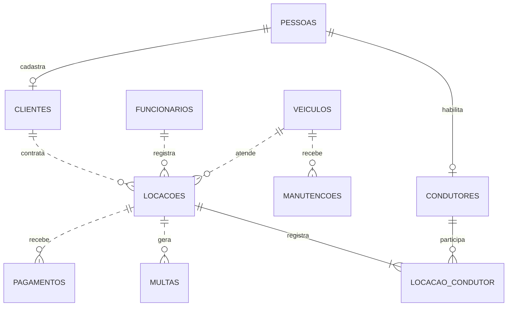

# Sistema para locação de veículos
## Seminário II de Banco de Dados II

Universidade Estadual de Montes Claros — Centro de Ciências Exatas e Tecnológicas  
Curso de Sistemas de Informação  
Júlia Maria Oliveira Silva e Pedro Augusto Mendes Barbosa

## Resumo

O sistema informatiza a abertura e a devolução de contratos de locação. O banco controla a disponibilidade da frota, valida a autorização dos condutores, preserva a diária contratada e apresenta valores pagos, multas e saldo. A aplicação Flask usa recursos do MySQL na gravação e na leitura das operações.

## Introdução e definição do sistema

A proposta dá continuidade ao trabalho de Banco de Dados I. A operação central é a locação de um veículo, registrada por um funcionário em nome de um cliente. Manutenções são eventos de um veículo específico. Pagamentos e multas pertencem ao contrato e podem ocorrer em momentos diferentes.

O estado da frota descreve a situação operacional atual. O escopo compreende retirada, devolução, cancelamento e manutenção da frota, com cobrança em dias e mínimo de uma diária. O cancelamento libera o veículo e preserva o histórico. Um valor recebido em uma locação cancelada continua visível no registro do contrato. O estorno financeiro é um procedimento administrativo externo ao protótipo.

## Modelagem

Cliente e condutor representam papéis de uma pessoa e compartilham o CPF. A validade da CNH pertence ao condutor. A autorização pertence à combinação de locação e condutor, o que permite dois ou mais condutores no mesmo contrato. Cada veículo pode ter várias manutenções ao longo do tempo. O cadastro de funcionários representa os operadores da aplicação.

A aplicação insere a locação e todos os condutores em uma transação e exige pelo menos uma autorização. O dicionário de dados descreve tipos, tamanhos, chaves e nulabilidade. As sentenças de criação estão em `sql/01_schema.sql`.

## Implementação e automação

| Recurso | Uso no sistema |
| --- | --- |
| `sp_finalizar_locacao` | Chamado pela API ao finalizar. Bloqueia o contrato, exige estado ativo, valida a data real e atualiza contrato e devolução. A transação é confirmada pela aplicação. |
| `trg_locacao_abertura` | Reserva de forma atômica o veículo disponível, copia a tarifa vigente e calcula o valor previsto. |
| `trg_locacao_transicao` | Preserva os dados contratuais e calcula a cobrança sobre o período efetivo na devolução. Finalização e cancelamento liberam a frota. |
| `trg_locacao_preservar` | Impede a exclusão física de contratos. |
| `trg_cnh_autorizacao` | Confere se a CNH estava válida na retirada e se o contrato está ativo ao registrar o vínculo. |
| `trg_manutencao_abertura`, `trg_manutencao_conclusao` | Bloqueiam a frota para manutenção e liberam o veículo ao concluir o serviço. |
| `trg_manutencao_preservar` | Preserva o histórico do veículo ao impedir a exclusão física de manutenções. |
| `vw_locacoes_detalhadas` | Alimenta a tela de locações e o painel. Soma pagamentos e multas separadamente para evitar duplicação ao combinar duas relações 1:N. |
| `vw_veiculos_disponiveis` | Alimenta o painel de veículos disponíveis e a consulta de disponibilidade na API. |
| `vw_faturamento_frota` | Soma pagamentos registrados por modelo em contratos finalizados, com os respectivos números de locações. |
| `ix_locacoes_status_retirada` | Atende consultas de locações por situação e intervalo de retirada. |
| `ix_manutencoes_veiculo_inicio` | Atende consultas de histórico por placa e data de início. |
| `ix_veiculos_status_modelo` | Atende consulta de disponibilidade filtrada por status e ordenada por marca e modelo. |

O arquivo `docs/benchmark_explain.sql` compara o plano escolhido com e sem os índices específicos, usando `IGNORE INDEX` sem remover índices da base. Em um conjunto pequeno, o otimizador pode escolher leitura completa. A verificação considera `key`, `rows` e a necessidade de ordenação adicional, com o mesmo filtro e os mesmos dados nos dois planos.

## Demonstração de comandos e resultados

O roteiro `sql/06_demonstracao.sql` inclui cadastro com `INSERT`, listagem com relacionamento entre tabelas e `JOIN`, alteração com `UPDATE`, encerramento com `CALL` e exclusão com `DELETE` de um cadastro temporário sem vínculos. A demonstração cadastra uma locação com dois condutores, altera a tarifa da frota, encerra a locação e registra uma manutenção. A tarifa contratada permanece no contrato e o estado da frota acompanha cada operação.

### Resultados verificados

A demonstração executada no MySQL retornou diária contratada de R$ 150,00 após o reajuste da tarifa para R$ 180,00. A devolução após três dias, com R$ 30,00 em multas, apresentou cobrança de R$ 480,00 e saldo de R$ 0,00 após pagamento. Uma disputa entre abertura de locação e início de manutenção sobre a mesma placa aceitou uma operação e bloqueou a outra.

Nos três pares de consultas com `EXPLAIN`, o MySQL usou os índices definidos. Ao aplicar `IGNORE INDEX` às mesmas consultas, o plano exibiu leitura completa e ordenação adicional. Esse resultado representa o plano escolhido para os dados de demonstração.

## Referências

- ALMEIDA, Leandro Clementino. *A linguagem SQL*. Material de Banco de Dados I. Unimontes.
- UNIMONTES. *Seminário II*. Roteiro de Banco de Dados II.
- UNIMONTES. *Stored Procedure, SQL Avançada — Trigger, SQL Avançada — Views e Indexação — conceitos e prática*. Materiais de Banco de Dados II.
- OLIVEIRA SILVA, Júlia Maria; BARBOSA, Pedro Augusto Mendes. *Sistema para locação de veículos*. Seminário de Banco de Dados I, 2026.
